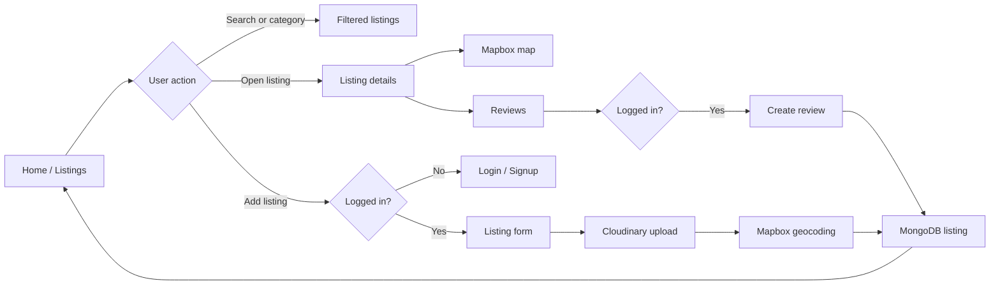
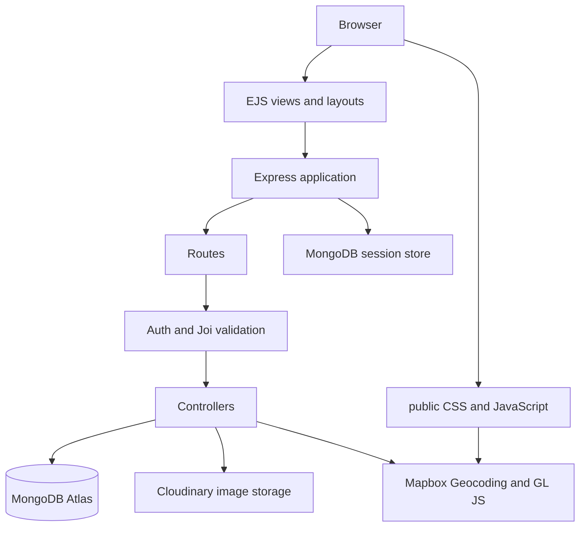
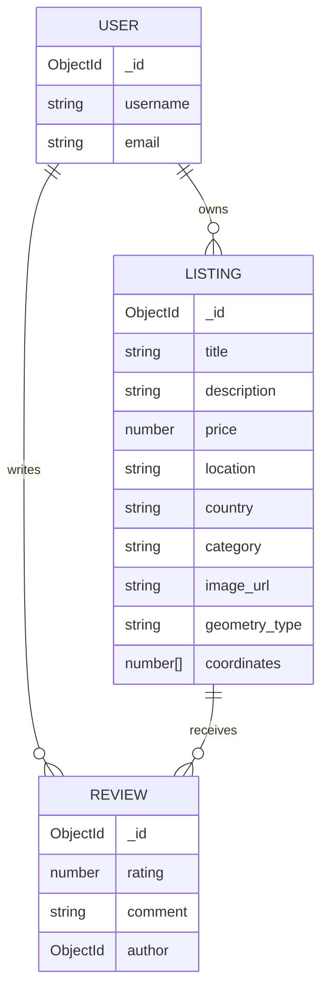

# Trip Stay

> A full-stack accommodation listing platform where users can discover stays, create listings, upload property images, view locations on an interactive map, and share reviews.

Trip Stay is an Airbnb-inspired major project built with Node.js, Express, MongoDB, and EJS. It combines server-rendered pages with secure authentication, image hosting, geocoding, map visualisation, category filtering, and review management.

---

## Project at a glance

```text
                         TRIP STAY
                             |
       +---------------------+---------------------+
       |                     |                     |
   Discover              Publish                Engage
       |                     |                     |
  Browse stays        Add a listing          Read reviews
  Search by place     Upload photos          Write reviews
  Filter categories   Add location           Delete own review
  Open details        Edit/delete own stay
                             |
                      Mapbox location view
```

## Features

### Guest experience

- Browse all available listings.
- Search listings by location or country.
- Filter listings by travel category.
- Open a detailed listing page.
- View an interactive Mapbox map with the listing location.
- See a privacy-friendly location radius instead of an exact address.
- Read ratings and reviews.

### Account and security

- User signup and login.
- Passport Local authentication.
- Persistent login sessions stored in MongoDB.
- Flash messages for success and error feedback.
- Protected routes for creating listings and posting reviews.
- Owner-only edit and delete controls for listings.
- Review-author-only review deletion.

### Listing management

- Create a listing with title, description, price, location, country, category, and image.
- Upload listing images to Cloudinary.
- Convert a location into GeoJSON coordinates using Mapbox Geocoding.
- Edit listing information and optionally replace the image.
- Delete a listing and its associated reviews.

### UI

- Responsive EJS layouts using EJS Mate.
- Bootstrap components and utility classes.
- Font Awesome icons.
- Horizontal category filter navigation.
- Star-based rating interface.
- Custom map marker and location radius overlay.

---

## Screens and user flow



## Architecture



## Request lifecycle

```text
1. Browser sends a request
2. Express parses the request and applies session/auth middleware
3. Route middleware checks authentication, ownership, and input validation
4. Controller performs the business operation
5. MongoDB stores application data
6. Cloudinary stores listing images
7. Mapbox converts locations into map coordinates
8. EJS renders the response
```

---

## Tech stack

| Layer | Technology |
| --- | --- |
| Runtime | Node.js |
| Server | Express 5 |
| Language | JavaScript, CommonJS |
| Templating | EJS + EJS Mate |
| Database | MongoDB with Mongoose |
| Authentication | Passport + Passport Local |
| Sessions | Express Session + Connect Mongo |
| Validation | Joi |
| Image storage | Cloudinary + Multer |
| Geocoding | Mapbox Geocoding API |
| Maps | Mapbox GL JS |
| Map radius | Turf.js CDN |
| Styling | Bootstrap, custom CSS |
| Icons | Font Awesome |

---

## Project structure

```text
trip-stay/
├── app.js                    # Express app, middleware, DB connection, server
├── cloudConfig.js            # Cloudinary and Multer storage configuration
├── middleware.js             # Authentication, ownership, and validation guards
├── schema.js                 # Joi validation schemas
├── package.json              # Dependencies and project metadata
│
├── controllers/
│   ├── listing.js             # Listing CRUD, search, geocoding
│   ├── review.js              # Review creation and deletion
│   └── user.js                # Signup, login, logout
│
├── models/
│   ├── listing.js             # Listing and GeoJSON schema
│   ├── review.js              # Review schema
│   └── user.js                # Passport-enabled user schema
│
├── routes/
│   ├── listing.js             # Listing endpoints
│   ├── review.js              # Review endpoints
│   └── user.js                # Authentication endpoints
│
├── views/
│   ├── layouts/boilerplate.ejs
│   ├── listings/               # Index, details, create, edit pages
│   ├── user/                   # Login and signup pages
│   └── includes/               # Navbar, footer, flash messages
│
├── public/
│   ├── css/                    # Main styles and rating styles
│   └── js/                     # Frontend scripts and map logic
│
├── utils/
│   └── ExpressError.js         # Application error helper
│
└── init/
    └── data.js                 # Sample listing data
```

---

## Routes

### Listings

| Method | Route | Description | Access |
| --- | --- | --- | --- |
| GET | `/listing` | View listings, search, and filter by category | Public |
| GET | `/listing/new` | Display create-listing form | Logged in |
| POST | `/listing` | Create a listing with image upload | Logged in |
| GET | `/listing/:id` | View listing details and map | Public |
| GET | `/listing/:id/edit` | Display edit form | Listing owner |
| PUT | `/listing/:id` | Update a listing | Listing owner |
| DELETE | `/listing/:id` | Delete a listing | Listing owner |

### Users

| Method | Route | Description | Access |
| --- | --- | --- | --- |
| GET | `/signup` | Display signup form | Public |
| POST | `/signup` | Create a user account | Public |
| GET | `/login` | Display login form | Public |
| POST | `/login` | Authenticate a user | Public |
| GET | `/logout` | End the current session | Logged in |

### Reviews

| Method | Route | Description | Access |
| --- | --- | --- | --- |
| POST | `/listing/:id/reviews` | Add a review | Logged in |
| DELETE | `/listing/:id/reviews/:reviewId` | Delete a review | Review author |

---

## Data model



Listing locations are stored as GeoJSON:

```js
{
    type: "Point",
    coordinates: [longitude, latitude]
}
```

---

## Getting started

### Prerequisites

Install the following before running the project:

- Node.js 18 or later
- npm
- A MongoDB Atlas database or local MongoDB instance
- A Cloudinary account
- A Mapbox access token

### 1. Clone and enter the project

```bash
git clone <your-repository-url>
cd "Major Project's"
```

### 2. Install dependencies

```bash
npm install
```

### 3. Create the environment file

Create a `.env` file in the project root:

```env
ATLASDB_URL=mongodb+srv://<username>:<password>@<cluster>/<database>
SECRETE=replace-with-a-long-random-session-secret

CLOUD_NAME=your-cloudinary-cloud-name
CLOUD_API_KEY=your-cloudinary-api-key
CLOUD_API_SECRET=your-cloudinary-api-secret

MAP_TOKEN=your-mapbox-public-token
```

Do not commit `.env` or expose API secrets in client-side code.

### 4. Start the application

```bash
node app.js
```

The app runs at:

```text
http://localhost:8080
```

### Optional development workflow

If you use Nodemon locally:

```bash
npx nodemon app.js
```

The current project does not define an `npm start` script. You can add one to `package.json` if desired:

```json
{
  "scripts": {
    "start": "node app.js",
    "dev": "nodemon app.js"
  }
}
```

---

## Environment variables

| Variable | Purpose |
| --- | --- |
| `ATLASDB_URL` | MongoDB connection string |
| `SECRETE` | Session encryption/signing secret |
| `CLOUD_NAME` | Cloudinary cloud name |
| `CLOUD_API_KEY` | Cloudinary API key |
| `CLOUD_API_SECRET` | Cloudinary API secret |
| `MAP_TOKEN` | Mapbox public access token |
| `NODE_ENV` | Optional environment name; `.env` is loaded outside production |

If the map or image upload fails, first verify that `MAP_TOKEN` and the Cloudinary variables are loaded in the same shell where the server is started.

---

## Core implementation notes

### Image uploads

Listing images are received through Multer and uploaded to the `tripstay_DEV` Cloudinary folder. The saved listing stores the Cloudinary URL and filename.

### Location privacy

The listing location is geocoded with Mapbox during creation. The details page displays a map marker and a 5 km visual radius so the exact property address is not exposed.

### Validation and authorisation

Joi validates listing and review payloads. Passport protects account-based actions, while ownership middleware prevents users from editing or deleting another user's listing or review.

### Sessions

Sessions use Connect Mongo so login state can survive application restarts and multiple server instances more reliably than in-memory sessions.

---

## Troubleshooting

### MongoDB connection failed

- Check that `ATLASDB_URL` exists in `.env`.
- Confirm the database user and password are correct.
- Add your current IP address to the MongoDB Atlas network access list.

### Map does not load

- Confirm `MAP_TOKEN` is present.
- Check the browser console for Mapbox token or coordinate errors.
- Ensure coordinates are ordered as `[longitude, latitude]`.
- Confirm the listing has valid GeoJSON geometry.

### Cloudinary upload failed

- Verify all three Cloudinary variables.
- Check Cloudinary upload permissions.
- Confirm the form uses a file input with the expected field name: `listing[image]`.

### Login does not persist

- Check `SECRETE`.
- Confirm `ATLASDB_URL` is valid because sessions are stored in MongoDB.
- Make sure cookies are enabled in the browser.

---

## Future improvements

- Add booking and reservation workflows.
- Add availability calendars.
- Add price and rating sorting.
- Add pagination for large listing collections.
- Add automated tests for routes and controllers.
- Add a production start script and deployment configuration.
- Add rate limiting and stronger upload validation.
- Add a user profile and saved-listings feature.

---

## Academic project note

Trip Stay was developed as a full-stack web development major project to demonstrate:

- MVC architecture
- RESTful routing
- Authentication and authorisation
- NoSQL data modelling
- Third-party API integration
- Cloud media storage
- Server-rendered UI design
- Geospatial data and interactive maps

---

## License

This project is currently marked as `ISC` in `package.json`. Add a formal license file before distributing the project publicly.

---

<div align="center">

### Made with Node.js, Express, MongoDB, and a lot of travel inspiration

</div>
